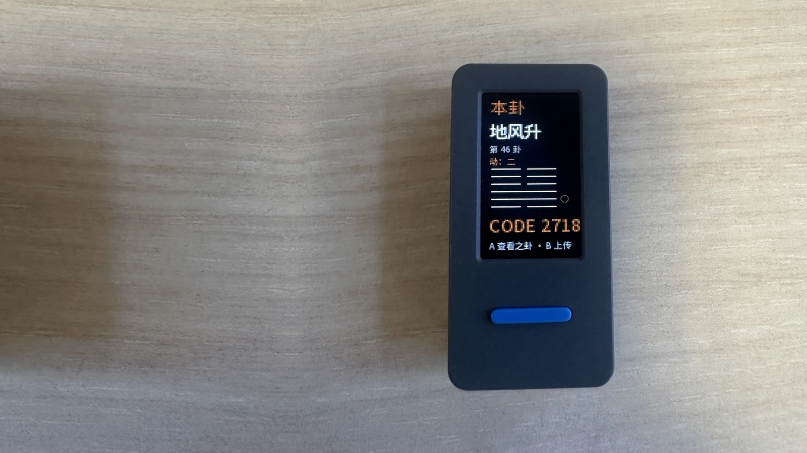
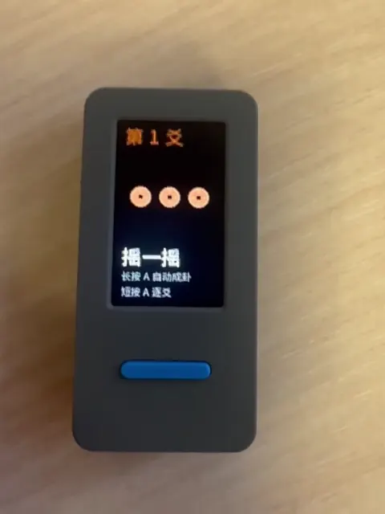
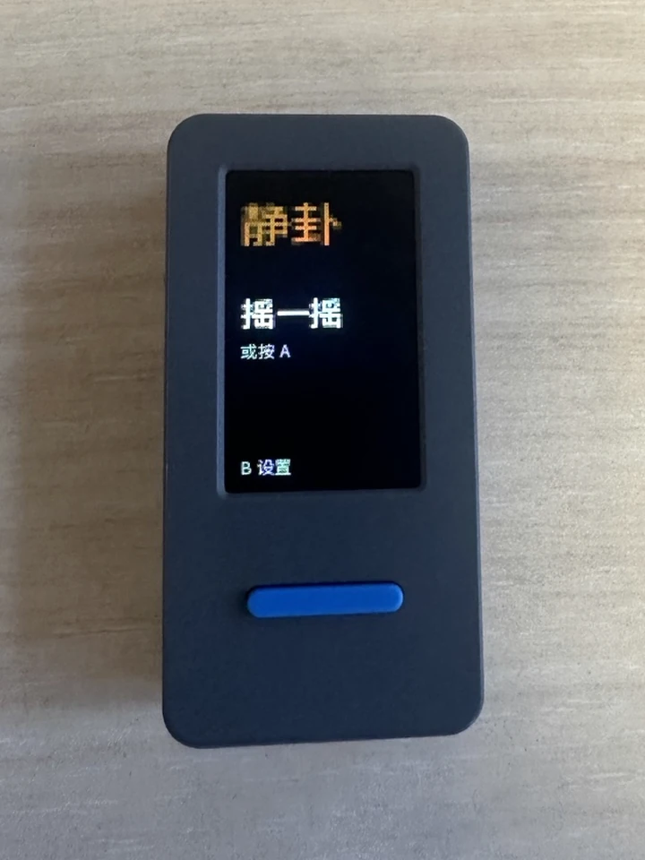
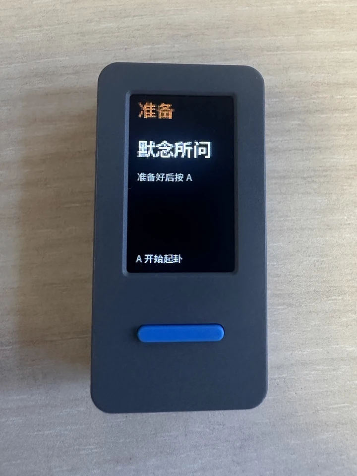
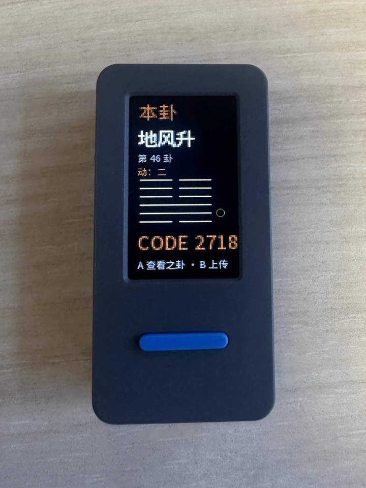

# 静卦 · JingGua Pocket

> **把一卦，握在手里。**

一台可以放进掌心的六爻起卦设备。拿起来，摇一摇；三枚铜钱，六次起落，在小小的屏幕上看见一卦。

*A pocket-sized I Ching casting device. Shake, cast, and reflect — offline first.*

[**体验静卦网页版**](https://gua.overme.cn/) · [**下载预览固件**](https://github.com/0verme/jinggua-pocket/releases/tag/v0.3.0) · [**了解如何烧录**](docs/quick-start.md)

<!-- README_MEDIA:HERO_START -->

<!-- README_MEDIA:HERO_END -->

## 把传统的起卦体验，装进口袋

静卦掌中版（JingGua Pocket）是 [静卦 JingGua](https://github.com/0verme/jinggua) 的硬件探索：不需要打开手机，也不用始终连接网络，就能完成一次起卦。

它不负责替你做决定，只想为一个问题留出片刻安静。

## 一次起卦，四个瞬间

1. **静心问事** — 拿起设备，想好要问的问题。
2. **摇动或按下** — 摇一摇起爻，也可以短按 A，逐爻投出三枚铜钱。
3. **六爻成卦** — 起卦过程中长按 A 约 1 秒，可自动补齐尚未完成的爻；仍按原有铜钱与动画流程逐次生成。
4. **静观其变** — 在设备上查看本卦、动爻、之卦与离线卦象码（`CODE NNNN`）。

<!-- README_MEDIA:DEMO_START -->

  

*真实设备拍摄 · 9.27 秒连续操作，静音循环播放。* [观看 / 下载 MP4](assets/readme/demo.mp4)

<!-- README_MEDIA:DEMO_END -->

## 小小一台，能做什么？

| 体验 | 当前能力 |
| --- | --- |
| **摇一摇 / 按键起卦** | 支持 IMU Shake、A 短按逐爻及长按自动补全 |
| **三枚铜钱 · 六爻** | 本地生成阴阳、动爻、本卦与之卦，配合铜钱动画 |
| **离线优先** | 起卦和本地历史不依赖网络；启动时 Wi-Fi 默认关闭 |
| **离线卦象码** | 在结果页展示 `CODE NNNN`，方便记录当前卦象 |
| **掌中屏幕** | 面向 StickS3 竖屏设计的轻量界面与中文显示 |
| **按需联网** | 已有主动连接、结果上传及固件更新的软件路径；需按开发配置使用，相关真机验收仍待完成 |

<!-- README_MEDIA:SHOWCASE_START -->

  
  
  

*欢迎 · 准备 · 本卦结果。照片中的「地风升」与视频中的「水泽节」来自不同次起卦。*

<!-- README_MEDIA:SHOWCASE_END -->

## Pocket × Web：一卦，两种体验

**Pocket 负责起卦，Web 提供更完整的阅读体验。**

- **掌中版**：专注实体输入、本地六爻计算、简洁结果和离线历史。
- **[静卦网页版](https://gua.overme.cn/)**：提供更适合手机与桌面阅读的起卦、解卦体验。
- **联动方向**：设备已具备用户主动上传结果的基础软件能力；正式配网、设备绑定、二维码和历史自动同步**尚未交付**。离线卦象码与网页查询体验请以各自版本的实际支持情况为准。

两个项目分别维护：[JingGua Web 源码](https://github.com/0verme/jinggua) · [JingGua Pocket 源码](https://github.com/0verme/jinggua-pocket)。

## 想拿在手里试试？

**当前发布版本：[v0.3.0 累积预览版](https://github.com/0verme/jinggua-pocket/releases/tag/v0.3.0)**

面向 **M5Stack StickS3 / ESP32-S3**，已经提供 USB 烧录包和固件资产。第一次刷机请先阅读 [快速开始与限制说明](docs/quick-start.md)，校验下载文件并确认设备型号，不要把单独的 `firmware.bin` 当作整片镜像烧入。

这是开发预览版，**不等于完成全部真机验收**。长按手感、Shake、屏幕排版、音频、功耗与 OTA 等项目仍需逐项验证；当前 Pre-release 也无法通过固件固定的 `releases/latest` OTA 地址自动发现。

## 还在打磨什么？

| 阶段 | 方向 |
| --- | --- |
| **v0.1–v0.2** | 离线六爻、摇动交互、铜钱动效与小屏体验的软件基础 |
| **v0.3.0 Preview** | 长按自动成卦、离线历史与卦象码、主动 Wi-Fi/API、OTA 软件路径 |
| **后续探索** | 更自然的配网与分享、设备绑定、历史同步、语音交互 |
| **走向 v1.0** | 完整真机验证、稳定固件、外壳方案及正式发布准备 |

路线会随着实机测试调整。详见 [Roadmap](docs/roadmap.md) 与 [v0.3.0 发布说明](docs/releases/v0.3.0.md)。语音与外壳目前仍处于研究或设计阶段，不代表已交付成品。

## 给想自己动手的开发者

项目基于 **M5Stack StickS3、ESP32-S3、PlatformIO 与 Arduino Framework**。完整的硬件参数、架构、编译、测试、Wi-Fi/API 开发配置不再挤占产品首页：

- [工程与开发指南](docs/development.md) — 编译、烧录、测试命令及开发配置
- [硬件说明](docs/hardware.md) — 设备、引脚/外设依据与硬件边界
- [架构设计](docs/architecture.md) — Domain、Application、Hardware、UI 分层
- [卦象算法](docs/divination-model.md) — 三枚铜钱、六爻与动爻变换
- [快速开始](docs/quick-start.md) — 预览固件下载、USB 烧录与已知限制
- [完整技术文档](docs/) — 状态机、动画、电源、字体、API 与 OTA

## 关于隐私与使用边界

本地起卦不会自动联网；设备不会上传你所问的问题原文。Wi-Fi、结果上传与 OTA 均由用户明确操作触发。具体网络行为和开发配置见 [工程与开发指南](docs/development.md) 与 [API 契约](docs/api-contract.md)。

静卦用于传统文化体验与自我反思，不替代医疗、法律、财务或其他专业建议。

## 许可证

本项目原创代码与文档采用 **[Apache License 2.0](LICENSE)** 开源，Copyright © 2026 0verme。

你可以按照 Apache 2.0 条款使用、修改与分发（包括商业用途），并须遵守相应的版权、许可与变更声明要求。第三方代码与资源继续遵循其各自的许可证；例如 `cad/issue-15/reference/` 中的 [M5Stack MIT 许可](cad/issue-15/reference/LICENSE) 不因本项目选用 Apache 2.0 而改变。
